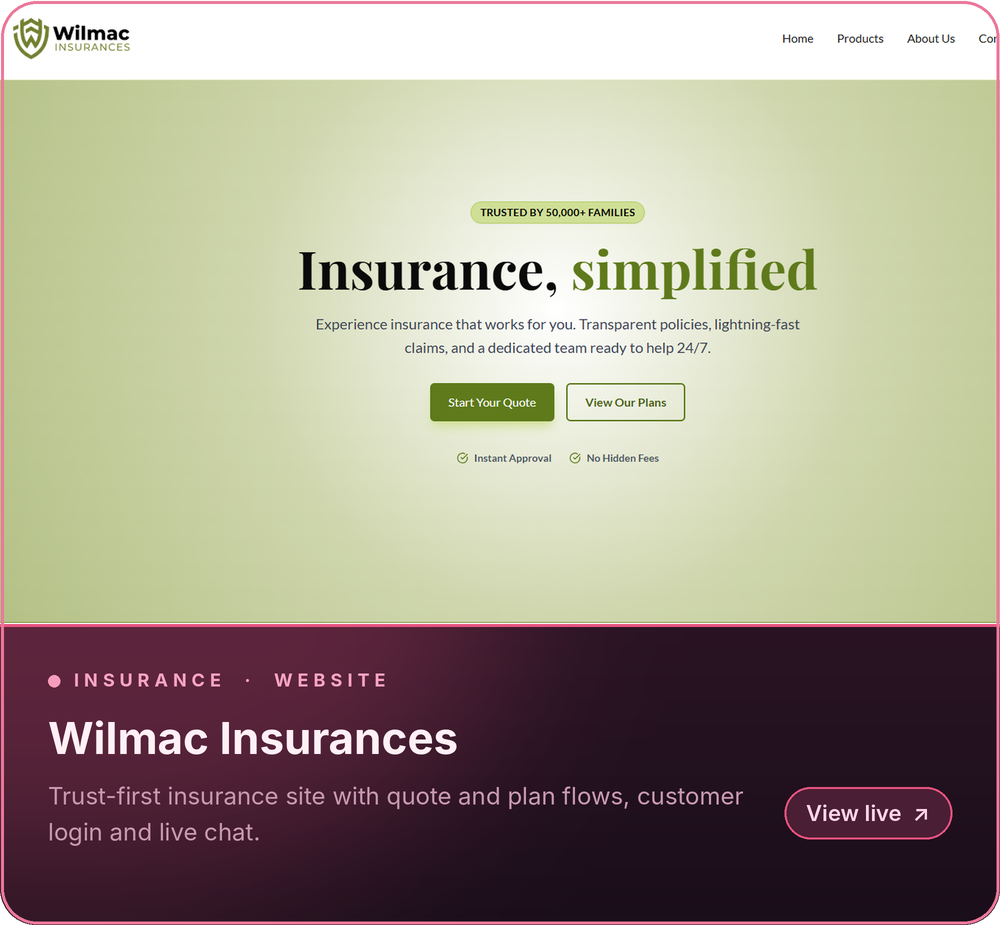
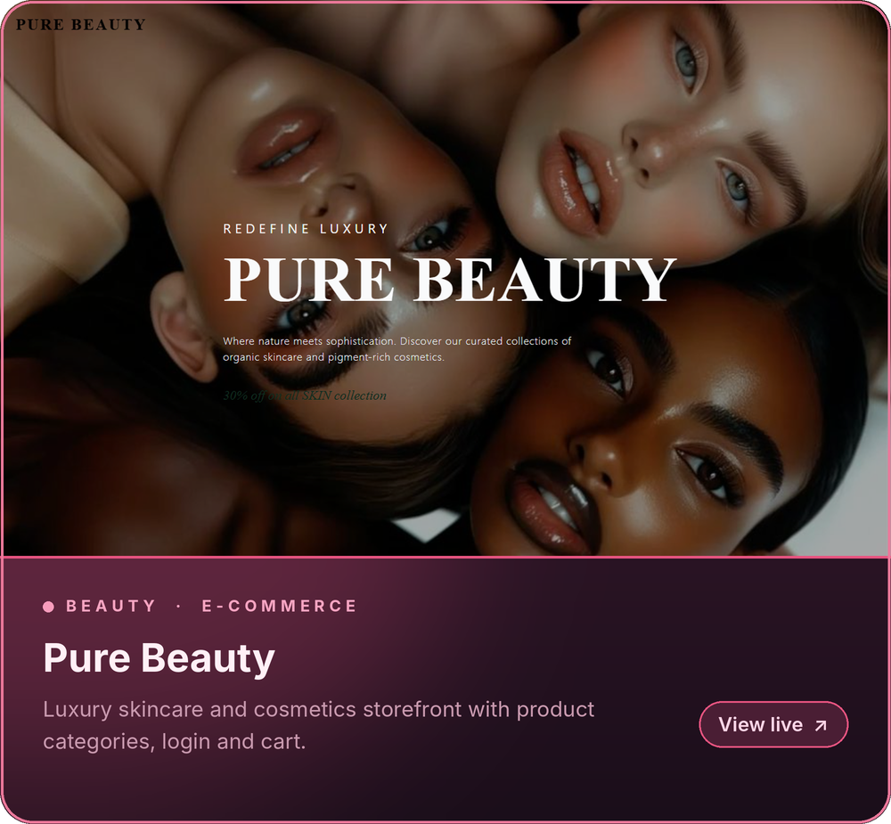
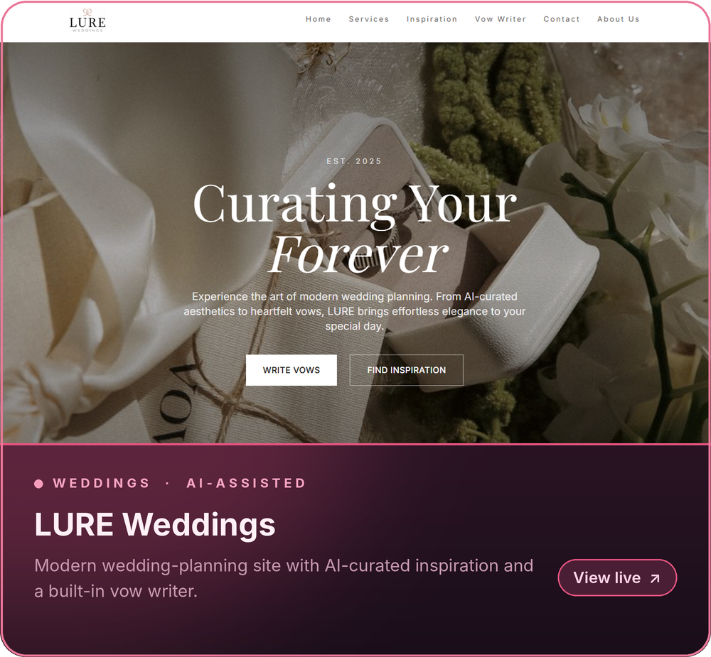

<!-- Header --> 
  
 
  
 
    

🌸 About Me

I'm a Software Developer and final-year Computer Science student at the Tshwane University of Technology, currently interning at ICEP. I enjoy owning a system end-to-end, from ERD and database design through to backend, frontend and cloud deployment, and I'm especially drawn to products where AI meets security and user safety.

<ul> <li>🎀 &nbsp;Building a facial-recognition attendance system in a 15+ person Agile team at <b>ICEP</b></li> <li>🎀 &nbsp;Passionate about biometrics, identity verification and secure-by-design software</li> <li>🎀 &nbsp;Certified in <b>AWS Cloud Foundations</b> and <b>Oracle Cloud DevOps Professional</b></li>  </ul> 
 <h2>🌸 Featured Projects</h2>

  
  
  

 
 <h2>🛠️ Tech Stack</h2>

  

 <h2>🎀 Certifications</h2>

  

 
 <i>"Building technology that keeps people safe, one commit at a time."</i> 🌷 
 
  

